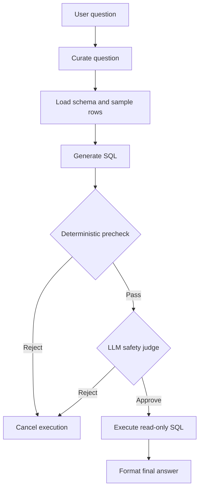
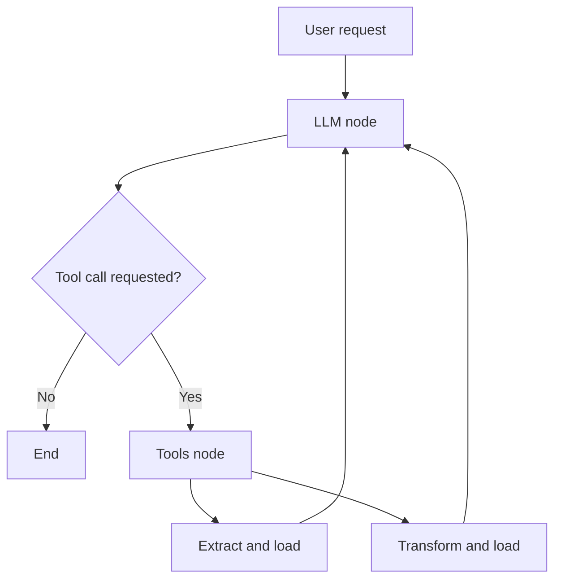

<div align="center">

# Data Agent

**Natural-language database analysis and file-based ETL, powered by LLMs and LangGraph.**

Python 3.12+ · PostgreSQL · pandas · LangGraph · OpenAI

[Overview](#overview) · [Getting Started](#getting-started) · [Usage](#usage) · [Architecture](#architecture) · [Security](#security-and-operational-guidance)

</div>

---

## Overview

Data Agent is a Python project with two complementary workflows: a **SQL analyst** that answers natural-language questions against PostgreSQL, and an **ETL analyst** that extracts JSON data from HTTP endpoints, transforms it with pandas, and saves the results to local files.

Both workflows use LangGraph to coordinate LLM reasoning and execution. They run as independent graphs, allowing you to use either workflow on its own.

> **Project status:** Prototype. SQL execution includes defensive safety checks, but generated Python transformations do not run in a hardened security sandbox. Review the [security guidance](#security-and-operational-guidance) before working with sensitive data or production systems.

### Choose a workflow

| Workflow | Use it when you want to… | Typical output |
| --- | --- | --- |
| **SQL analyst** | Ask a question about data already stored in PostgreSQL | A read-only query result and a concise explanation |
| **ETL analyst** | Download JSON data, apply transformations, and save a dataset | CSV, JSON Lines, Parquet, or Excel files |

### Capabilities

**SQL analysis**

- Convert natural-language questions into PostgreSQL queries.
- Inspect schema metadata and sample rows to inform SQL generation.
- Validate SQL with deterministic checks followed by an LLM safety judge.
- Execute approved read-only queries and summarize their results.
- Apply a default row limit when a generated query has no `LIMIT`.

**Data extraction and transformation**

- Extract JSON data from one or more HTTP URLs.
- Normalize supported JSON payloads into pandas DataFrames.
- Generate pandas transformation code from natural-language instructions.
- Coordinate extraction and transformation through LLM-selected tool calls.
- Save datasets in four supported output formats.

## Contents

- [Getting Started](#getting-started)
- [Configuration](#configuration)
- [Usage](#usage)
- [Output Formats](#output-formats)
- [Architecture](#architecture)
- [Project Structure](#project-structure)
- [Testing](#testing)
- [Troubleshooting](#troubleshooting)
- [Security and Operational Guidance](#security-and-operational-guidance)
- [Limitations](#limitations)

## Getting Started

### Prerequisites

| Requirement | Purpose |
| --- | --- |
| Python **3.12 or newer** | Run the application |
| OpenAI API key | Authenticate LLM requests |
| Network access to the configured LLM service | Generate queries, transformations, and responses |
| Network access to source URLs | Download data with the ETL workflow |
| Reachable PostgreSQL database | Required only for the SQL workflow |
| Format-specific dependencies | Required when writing Parquet or Excel |

Project dependencies are declared in [`pyproject.toml`](./pyproject.toml).

### 1. Install the project

Open a terminal in the project root, then create and activate a virtual environment.

**Windows — PowerShell**

```powershell
py -3.12 -m venv .venv
.\.venv\Scripts\Activate.ps1
python -m pip install --upgrade pip
python -m pip install -e .
```

**macOS / Linux — Bash**

```bash
python3.12 -m venv .venv
source .venv/bin/activate
python -m pip install --upgrade pip
python -m pip install -e .
```

Editable installation (`-e`) lets changes to the project source take effect without reinstalling the package.

### 2. Configure the environment

Create a `.env` file in the project root using the variables in [Configuration](#configuration). Add PostgreSQL credentials if you plan to use the SQL analyst.

### 3. Run a workflow

Run these commands from the project root with the virtual environment activated:

```bash
# Run the SQL analyst's bundled example.
python agent/sql_analyst.py

# Run the ETL analyst's bundled example.
python agent/etl_analyst.py
```

Review the example request and any configured output paths in the relevant script before running it.

## Configuration

### Environment variables

```dotenv
# Required for both workflows
OPENAI_API_KEY=your_api_key_here

# Required only for the SQL analyst
HOST=localhost
PORT=5432
DATABASE=your_database
USER=your_database_user
PASSWORD=your_database_password
```

| Variable | Required for | Description |
| --- | --- | --- |
| `OPENAI_API_KEY` | SQL and ETL | API key used by the configured OpenAI client |
| `HOST` | SQL | PostgreSQL host name or IP address |
| `PORT` | SQL | PostgreSQL port; commonly `5432` |
| `DATABASE` | SQL | Database to query |
| `USER` | SQL | Database user; use a role with read-only permissions |
| `PASSWORD` | SQL | Password for the database user |

Keep `.env` out of version control. Never include real credentials in examples, prompts, logs, or committed files.

### Application settings

| Component | Configuration location |
| --- | --- |
| LLM tier definitions and SQL safety limits | [`config/settings.py`](./config/settings.py) |
| Model selection and client creation | [`utils/llm_switch.py`](./utils/llm_switch.py) |
| SQL, safety, response, and ETL prompts | [`utils/prompts.py`](./utils/prompts.py) |
| Database connection setup | [`utils/db_connection.py`](./utils/db_connection.py) and [`utils/database.py`](./utils/database.py) |

The SQL workflow uses the `public` schema by default and adds a row limit of **10** when a query does not already contain `LIMIT`. A row limit controls returned rows; it does not guarantee that a query will be inexpensive to execute.

## Usage

### SQL analyst: ask a database question

The SQL graph curates the request, loads schema context, generates SQL, evaluates safety, executes an approved query, and produces a final response.

```python
from agent.sql_analyst import build_graph

graph = build_graph().compile()

result = graph.invoke(
    {
        "messages": [],
        "user_input": "How many orders were placed last month?",
    }
)

print(result["final_response"])
```

Adapt the question to the tables and business concepts available in your database.

The runnable example in [`agent/sql_analyst.py`](./agent/sql_analyst.py) prints the curated question, generated SQL, safety verdict, execution result, and final response. It also generates a graph diagram when the optional rendering dependencies are available.

### ETL analyst: extract and transform in one request

Describe the source, extraction destination, transformation, and final destination in a single message. Specify the format for **each stage**, especially when the extracted and transformed files use different formats.

```python
from langchain_core.messages import HumanMessage

from agent.etl_analyst import etl_analyst_graph
from models.schema import ETLGenerationSchema

state = ETLGenerationSchema(
    messages=[
        HumanMessage(
            content=(
                "Extract JSON data from https://example.com/data.json "
                "and save the extracted dataset to data/extracted as CSV. "
                "Then transform that extracted dataset: keep only the id "
                "and name columns, and save the transformed result to "
                "data/transformed as JSON Lines."
            )
        )
    ]
)

final_state = etl_analyst_graph.invoke(state)

# Handle either a mapping or a state-model result.
messages = (
    final_state["messages"]
    if isinstance(final_state, dict)
    else final_state.messages
)

for message in messages:
    print(message)
```

`https://example.com/data.json` is a placeholder. Replace it with a reachable endpoint returning compatible JSON, and use column names that exist in the downloaded data.

### ETL tools: call operations directly

Use direct tool calls when you want to supply explicit arguments for each operation.

**Extract and save**

```python
from agent.etl_analyst import extract_load_tool

extraction_result = extract_load_tool.invoke(
    {
        "url": "https://example.com/data.json",
        "output_path": "data/extracted",
        "format": "csv",
        "mode": "overwrite",
    }
)

print(extraction_result)
```

**Transform and save**

```python
from agent.etl_analyst import transform_load_tool

transformation_result = transform_load_tool.invoke(
    {
        "input_file_path": "data/extracted/data_0.csv",
        "output_path": "data/transformed",
        "format": "json",
        "user_question": "Keep only the id and name columns.",
    }
)

print(transformation_result)
```

Use the actual file path produced by extraction as `input_file_path`; `data_0.csv` is an illustrative filename. Review the destination before using `mode="overwrite"`, as existing output may be replaced.

## Output Formats

| Tool value | Output | Suitable for |
| --- | --- | --- |
| `csv` | Comma-separated values | Flat tables, inspection, and broad tool compatibility |
| `json` | JSON Lines: one JSON object per line | Record-oriented processing and downstream ingestion |
| `parquet` | Columnar Parquet files | Analytical datasets and column-oriented reads |
| `xlsx` | Excel workbook | Spreadsheet review and sharing |

> **JSON format:** The `json` option writes **JSON Lines**, not a single JSON array. When reading this output with pandas, use `pd.read_json(path, lines=True)`.

Parquet and Excel require compatible runtime dependencies. Consult [`pyproject.toml`](./pyproject.toml) and install any missing format-specific engine in the active environment.

## Architecture

### SQL analyst

The SQL workflow combines schema-aware generation with two stages of safety evaluation.



The safety layer is designed to **fail closed**: SQL must pass the checks before execution is allowed. The deterministic precheck rejects empty, oversized, multi-statement, non-`SELECT`/`WITH`, and forbidden-operation queries before calling the LLM judge.

Implementation: [`agent/sql_analyst.py`](./agent/sql_analyst.py) and [`utils/safety.py`](./utils/safety.py).

### ETL analyst

The ETL workflow loops between LLM reasoning and tool execution. A request can require extraction, transformation, or multiple tool calls before the final response.



Extraction normalizes compatible remote JSON into DataFrames. Transformation generates pandas code and executes it through `ETLTools.execute_code`, then writes the resulting data in the requested format.

Implementation: [`agent/etl_analyst.py`](./agent/etl_analyst.py) and [`utils/etl_tools.py`](./utils/etl_tools.py).

### Shared components

| Component | Responsibility |
| --- | --- |
| [`models/schema.py`](./models/schema.py) | State models for the SQL and ETL graphs |
| [`utils/llm_switch.py`](./utils/llm_switch.py) | LLM client creation by configured tier |
| [`utils/prompts.py`](./utils/prompts.py) | Instructions for generation, safety evaluation, and responses |
| [`config/settings.py`](./config/settings.py) | LLM tiers and SQL safety settings |

## Project Structure

| Path | Purpose |
| --- | --- |
| `agent/sql_analyst.py` | SQL analyst graph and runnable example |
| `agent/etl_analyst.py` | ETL analyst graph, tool wrappers, and runnable example |
| `config/settings.py` | Application settings and LLM tiers |
| `models/schema.py` | SQL and ETL graph state models |
| `utils/database.py` | PostgreSQL connection and query operations |
| `utils/db_connection.py` | Database utility factory |
| `utils/etl_tools.py` | Extraction, transformation, and file I/O |
| `utils/llm_switch.py` | LLM configuration and selection |
| `utils/prompts.py` | SQL, safety, response, and ETL prompts |
| `utils/safety.py` | Deterministic SQL safety checks |
| `tests/test_sql_analyst.py` | SQL workflow tests |
| `tests/test_etl_analyst.py` | ETL workflow tests |
| `pyproject.toml` | Project metadata and dependencies |
| `README.md` | Setup instructions and project documentation |

## Testing

Run the full test suite from the project root:

```bash
python -m pytest -q
```

Run a workflow's tests independently:

```bash
python -m pytest tests/test_sql_analyst.py -q
python -m pytest tests/test_etl_analyst.py -q
```

The test suite mocks database, network, and LLM interactions so tests can run without live services or credentials. Passing mocked tests does not establish that a particular database, endpoint, or model configuration works; validate those integrations separately in a controlled environment.

## Troubleshooting

| Symptom | What to check |
| --- | --- |
| LLM authentication fails | Confirm that the application loads the intended `OPENAI_API_KEY` and that the configured model is accessible. |
| PostgreSQL connection fails | Check the host, port, database, credentials, network access, and database role permissions. |
| A query is rejected | Inspect the generated SQL and safety verdict. Check query length, statement count, and forbidden operations. |
| Extraction fails | Verify the source URL is reachable and returns compatible JSON rather than an HTML page or error response. |
| Transformation cannot find its input | Check the actual extraction output path and the working directory used to run the application. |
| Output uses an unexpected format | Inspect the tool-call arguments. Specify the extraction format and final transformation format separately. |
| JSON output is not a JSON array | This is expected: the `json` writer produces JSON Lines. Use a compatible reader. |
| Parquet or Excel writing fails | Check that the required writer engine is installed in the active Python environment. |

## Security and Operational Guidance

### SQL execution

Deterministic checks and the LLM judge are defensive controls, not a guarantee that every accepted query is safe or appropriate.

- Use a PostgreSQL role with only the required read permissions.
- Restrict database network access to approved hosts.
- Review generated SQL before using it against sensitive or production data.
- Apply database-level resource controls appropriate to the environment.
- Remember that schema context, sample rows, and query results may contain sensitive information; review what is sent to the configured model.

### Generated Python execution

`ETLTools.execute_code` executes Python generated by an LLM. **It is not a security sandbox.**

- Use trusted requests and trusted data sources.
- Review generated transformations before processing sensitive data.
- Use an isolated execution environment when evaluating untrusted content.
- Validate remote URLs and downloaded payloads before processing them.
- Treat generated files as untrusted until reviewed.

### Credentials and data handling

- Keep credentials out of version control, prompts, input files, and generated output.
- Use scoped API keys and rotate them according to your operational requirements.
- Give the application access only to the files, services, and data it needs.
- Check output paths and overwrite behavior before executing a workflow.

## Limitations

- The project is a prototype without a hardened Python execution sandbox.
- LLM-generated SQL, transformations, and summaries can be incorrect and may require review.
- SQL analysis requires a reachable PostgreSQL database and compatible schema metadata.
- Extraction depends on source endpoints returning compatible JSON; this workflow is not a general-purpose HTML scraper.
- Parquet and Excel support depend on installed runtime packages.
- The SQL and ETL agents are independent graphs; a unified router between the workflows is not described here.
- Mocked tests do not replace live integration validation.
